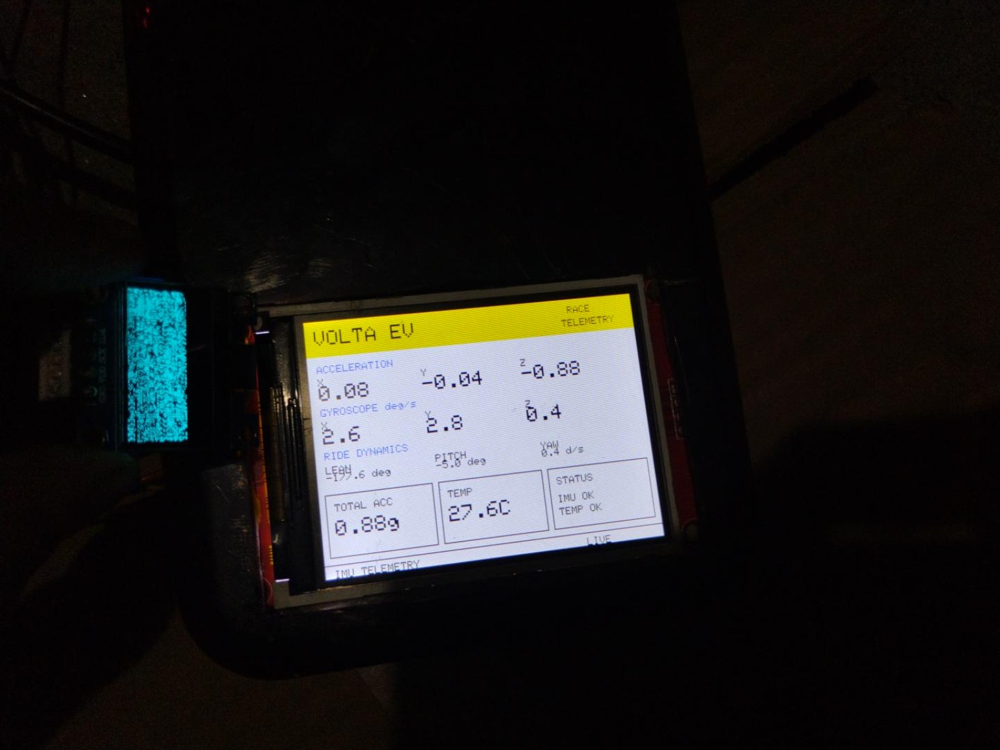
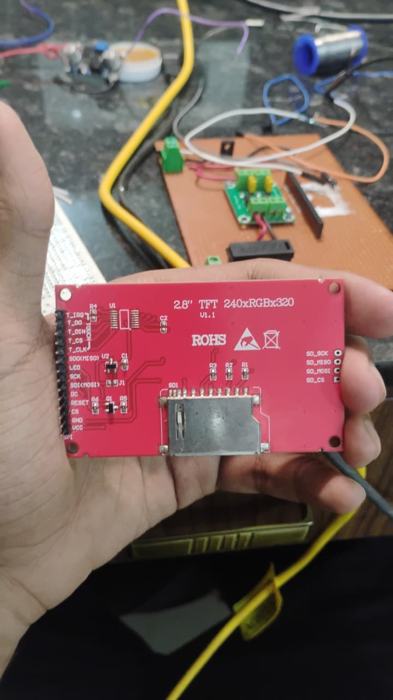

# RACE — EV Race Telemetry

Embedded telemetry and rider-safety display prototype for RACE. This repository contains the Arduino Nano Race Telemetry v6 firmware, wiring/documentation notes, test log, and locations for real prototype photographs.

## Current hardware
- Arduino Nano (ATmega328P) — primary display/sensor controller
- 2.8-inch 240×320 TFT using ST7789 driver
- SSD1306 128×64 OLED (I²C address 0x3C)
- MPU6050 IMU (I²C address 0x68)
- DS18B20 temperature sensor
- Buzzer
- ESP32 DevKit — GPS and microSD functions, if using the separate ESP32 firmware
- GY-GPS6MV2 / NEO-6M GPS and microSD module

## Repository contents
- `firmware/nano/nano_firmware.ino` — Nano Race Telemetry v6 source
- `firmware/esp32/` — place the final tested ESP32 GPS/SD/logger firmware here
- `firmware/tests/` — isolated module test sketches, if retained
- `hardware/photos/prototype/` — real prototype photos
- `hardware/photos/components/` — close-up component photos
- `hardware/schematics/` — wiring diagrams and schematic exports
- `docs/` — pinout, architecture, bill of materials and test log
- `results/` — evidence of working displays and serial/GPS/SD tests

## Nano build
Board: Arduino Nano / ATmega328P. Install these Arduino libraries using Library Manager:
- Adafruit GFX Library
- Adafruit ST7735 and ST7789 Library
- OneWire (the firmware reads the DS18B20 using raw OneWire commands)

The firmware also uses the Arduino `SPI` and `Wire` libraries. Select the correct processor/bootloader option for your Nano clone if upload fails.

### Nano pinout
| Device | Nano pin |
|---|---|
| TFT CS | D10 |
| TFT DC | D9 |
| TFT RESET | D8 |
| TFT SPI MOSI / SCK | D11 / D13 |
| TFT SPI MISO | D12 (if required by module) |
| DS18B20 data | D2 |
| Buzzer | D3 |
| MPU6050 SDA / SCL | A4 / A5 |
| OLED SDA / SCL | A4 / A5 |

Power on with the IMU mounted in its intended orientation and the bike upright and still so the firmware can calibrate. Verify sensor readings and warning thresholds before riding. The configured temperature warning is 50 °C and critical threshold is 56 °C.

## Prototype photos
Upload your own actual photos to `hardware/photos/` and use the exact filenames in the gallery below. Example filenames are placeholders; no stock/example images are included.

### Working dashboard (photo supplied for this project)

### TFT module — rear side

### ESP32 DevKit

### NEO-6M GPS module

Additional display and board photos are included in `results/` and `hardware/photos/`. Add a clear full-system photo and wiring photo when available.

## Build status
The project owner reports that the final Nano firmware was compiled and uploaded and that the hardware checks are complete. Keep ESP32 GPS/SD integration status aligned with the actual test evidence committed to `results/`.

Latest reported Nano build:
- Flash: 24,508 / 32,256 bytes (about 76%)
- SRAM: 855 / 2,048 bytes (about 42%)

## Limitations
IMU-derived lean and acceleration values are estimates and require validation against a known reference. The current hardware list does not include wheel-speed sensors, so wheel-slip/traction-slip detection should not be claimed. Battery power measurement is not available unless voltage and current sensing are added.

## License
No license is assigned yet. Add a license only after the project owners agree on reuse and distribution terms.
